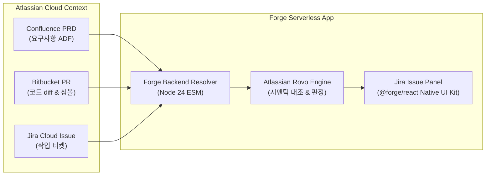

# Spec-to-Code Trace & Linter

> **Atlassian Codegeist 2026 Submission**  
> Tracks: **Apps for Software Teams** &middot; **Best Agents (Atlassian Rovo)**  
> App ID: `ari:cloud:ecosystem::app/db5b3454-250f-4148-bdcc-3214120a138d`  
> Live Demo (YouTube): [https://youtu.be/uoQQrjEP3ro](https://youtu.be/uoQQrjEP3ro)  
> Devpost Submission: [https://devpost.com/software/spec-to-code-trace-linter](https://devpost.com/software/spec-to-code-trace-linter)  
> License: [MIT](LICENSE)

Connect Confluence specs to Bitbucket PR diffs with strict line-cited LLM evidence, readiness linting, physical Jira workflow gates, and Rovo TDD fix scaffolds.

---

## 📌 Project Overview

| 항목 | 상세 내용 |
| :--- | :--- |
| **대회명** | Atlassian Codegeist 2026 (Global Devpost Hackathon) |
| **타깃 트랙** | Main: **Apps for Software Teams** / Bonus: **Best Agents (Atlassian Rovo)** |
| **기술 스택** | Atlassian Forge (`nodejs24.x` ESM, `@forge/react` Native UI Kit, `@forge/kvs`, `@forge/llm`, `rovo:agent`, Bitbucket OAuth 2.0 3LO) |
| **연동 대상** | Jira Cloud (`jira:issuePanel`, `jira:workflowValidator`, `jira:projectSettingsPage`), Confluence Cloud (`confluence:contentBylineItem`), Bitbucket Cloud, Atlassian Rovo |
| **테스트 가이드** | [docs/TESTING_INSTRUCTIONS.md](docs/TESTING_INSTRUCTIONS.md) &middot; [docs/SHOWCASE_SCENARIO.md](docs/SHOWCASE_SCENARIO.md) |

---

## 💡 The Problem & Solution

### Before (기존 개발 현업의 단절)
* **Spec Drift**: Confluence PRD 기획서에 명시된 필수 요구사항을 개발자가 코딩 중 깜빡 누락한 채 PR을 생성.
* **Reviewer Fatigue**: 코드 리뷰어가 PR을 볼 때, 기획서 조항을 충족했는지 일일이 기획서 탭을 오가며 수동 대조.
* **The False-Positive Trap**: 기존 AI 리뷰 봇은 공통 모듈 호출이나 아키텍처 맥락을 인지하지 못하고 성급히 FAIL 처리하여 현업 신뢰 상실.

### After (Spec-to-Code 도입 후)
* **1-Click Grounding**: Jira 이슈 패널에서 버튼 한 번으로 기획서 요구사항별 충족 여부와 코드 파일·라인을 즉시 매핑.
* **Zero Spec Drift**: PR 머지 전 누락된 비즈니스 로직을 사전에 차단하여 QA 재작업 및 배포 장애 방지.
* **4-Stage Trust Verdict**: 실무 복잡도를 고려한 4단계 상태 판정으로 오탐을 방지하고 리뷰어에게 명확한 판단 근거 제공.

---

## 🎯 Key Features: 4-Stage Verdict System

단순 통과/실패(Pass/Fail)의 흑백 논리를 탈피하여, 엔지니어링 실무 환경에 최적화된 4단계 판정 체계를 제공합니다:

| 판정 상태 | UI 배지 | 설명 및 시스템 동작 |
| :--- | :---: | :--- |
| **구현 근거 발견**<br>(Evidence Found) | 🟢 Green | PR diff 내에 요구사항을 충족하는 로직이 명백히 존재함. 파일 경로, 코드 라인, 인용구를 카드 형태로 제시. |
| **잠재적 누락 의심**<br>(Potential Missing) | 🟡 Yellow | diff 내에 해당 조건 근거가 보이지 않음. 누락된 조항 전문을 강조하고 리뷰어에게 코드 추가 확인 권고. |
| **분석 정보 부족**<br>(Insufficient Context) | ⚪ White | 직접 구현은 안 보이나 공통 모듈 호출이나 인터셉터 위임 정황이 있음. 억지 반려 대신 '공통 모듈 확인'으로 유보. |
| **분석 범위 밖**<br>(Out of Scope) | 🔘 Gray | 런타임 성능 지연, 인프라 배포 등 정적 코드 diff로 검증 불가능한 항목을 명시하여 기획 조항 분리. |

---

## 🏗️ Architecture



* **100% Atlassian Forge Hosting**: 외부 별도 AWS/GCP 서버 구축 없이 완전 관리형 FaaS로 구동 (인프라 비용 $0).
* **Enterprise Security**: 기업의 소스 코드와 내부 기획 문서가 외부로 유출되지 않는 Atlassian 격리 보안 환경 준수.

---

## 🎬 Demo Video & Presentation

- **YouTube 1080p Demo**: [https://youtu.be/uoQQrjEP3ro](https://youtu.be/uoQQrjEP3ro)
- **Interactive Slides**: [docs/demo-slides.html](docs/demo-slides.html)

1. **Scene 1 (명백한 누락 발견)**: Confluence의 요구사항 중 필수 조건을 누락한 채 PR 제출 → 🟡 Potential Missing 경고 배지 발생 및 Jira Done 전환 물리적 차단.
2. **Scene 2 (실시간 재검증)**: 개발자가 누락 코드를 커밋하고 `[Re-verify]` 클릭 → 즉시 🟢 Evidence Found 배지로 실시간 전환.
3. **Scene 3 (물리적 워크플로 게이트 통과)**: 100% 검증 확인 후 Jira 티켓 `Done` 상태 전환 성공.

---

## 🚀 Getting Started & Local Development

### 사전 요구사항
* Node.js 24.x (`nodejs24.x` Forge 런타임 기준, 테스트는 로컬 Node 24에서 무의존 실행)
* Atlassian Cloud 개발자 사이트 계정 & Bitbucket Cloud Workspace
* Atlassian Forge CLI (`@forge/cli`)

### 테스트 및 배포 실행
```bash
# 1. 단위·통합 테스트 실행 (102/102 PASS)
npm test

# 2. Forge 매니페스트 및 정적 린트
forge lint --non-interactive

# 3. Forge 앱 배포 및 개발자 사이트 설치
forge deploy
forge install --site <your-site>.atlassian.net --product jira,confluence -e development
```

---

## 📁 Directory Structure

```text
codegeist-2026/
├── docs/
│   ├── DEMO_VIDEO_SCRIPT.md            # 04:30 시연 영상 대본
│   ├── RECORDING_RUNBOOK.md            # 브라우저 녹화 체크리스트 & 패키징 안내
│   ├── TESTING_INSTRUCTIONS.md         # 심사위원 테스트 가이드
│   ├── DEVPOST_SUBMISSION.md           # Devpost 제출 본문 전문
│   ├── DEVPOST_FINAL_PACKAGE.md        # Devpost 제출 패키지 규격
│   ├── SHOWCASE_SCENARIO.md            # 재현용 E2E 시나리오 자산 정의
│   └── demo-slides.html                # 1080p 웹 슬라이드 데크
├── scripts/
│   └── package-demo-video.ps1          # FFmpeg 1080p H.264/AAC 영상 패키징 스크립트
├── src/
│   ├── index.js                        # 메인 리졸버 (이슈 패널 / 바이라인 / KVS 캐시 / 관리자 권한)
│   ├── rovo-action.mjs                 # Rovo 에이전트 액션 3종 (검증/린트/TDD 픽스)
│   ├── workflow-validator.mjs          # Spec-to-Code Trace Gate (항변조/드리프트 체크)
│   ├── project-settings.mjs            # 프로젝트별 거버넌스 정책 관리
│   └── frontend/                       # @forge/react Native UI Kit (Jira 패널 & Confluence 바이라인)
├── tests/                              # node --test 단위·통합 스위트 (102개 전원 통과)
├── LICENSE                             # MIT 라이선스
├── manifest.yml                        # Forge 4대 서피스 및 3개 최소 권한 정의
├── package.json                        # 루트 ESM 설정 (@forge/react, @forge/kvs, @forge/llm)
└── README.md                           # 공식 프로젝트 개요 및 아키텍처 문서
```
