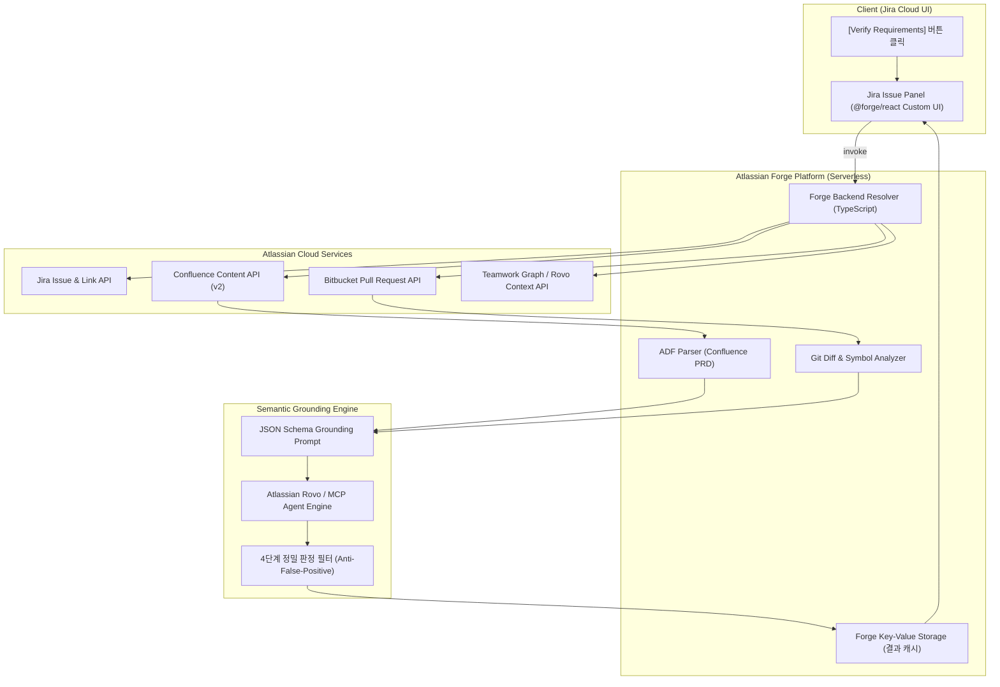

# Atlassian Codegeist 2026 Master Plan: Spec-to-Code Trace & Linter

## 현재 작업 계획 및 검증 기준 — 2026-11-11

환님이 Bitbucket OAuth 소비자 생성, Forge 배포·설치와 실제 연동 시험을 지시했다. 아래 본문의 기능·효과·일정 주장은 기획이며 실제 구현 및 검증 결과가 아니다. 현재 코드는 Jira 원격 링크의 PR 선택, Bitbucket OAuth와 diff 조회, Confluence 요구사항 추출, Forge LLM 판정 및 인용 검증을 연결한 로컬 알파다. 실제 설치와 전체 연결은 미검증이다.

1. **계정·대상 확인**: 현재 로그인된 Bitbucket 워크스페이스, Forge 개발 사이트, Jira·Confluence 접근과 시험 대상의 존재를 확인한다. 기존 소비자나 토큰을 건드리지 않는다. 없으면 실험 대상 준비 방법과 권한을 확인한다.
2. **OAuth 구성**: Bitbucket 소비자에 Forge 콜백과 account·pullrequest 권한을 설정하고, 클라이언트 ID 및 비밀키를 안전하게 Forge에 연결한다. 비밀값은 출력·기록·소스에 남기지 않는다. pullrequest 권한에는 저장소 읽기와 일부 협업 권한이 포함된다.
3. **배포·설치**: 로컬 테스트와 Forge lint를 다시 확인한 뒤 개발 환경에 배포하고 필요한 Jira·Confluence 연결을 설치한다. 설정·권한 문제는 실제 오류에 맞춰 해결하며 기존 인증을 임의 초기화하지 않는다.
4. **실제 연결 검증**: 시험용 이슈의 원격 링크에서 Confluence 문서와 PR을 찾아 OAuth 인증, diff 조회, 요구사항 추출을 확인한다. Forge LLM 유료 사용량 및 청구 설정을 확인한 후 최소한의 시험으로 판정·인용을 검증한다. 권한 거부·없는 링크·큰 diff·잘못된 AI 인용에 대한 오류 처리도 확인한다.
5. **결과 정리 및 다음 단계**: 실제 확인한 결과와 미검증 항목을 README에 갱신한다. 자동 PR 검색 범위, 요구사항 파싱, 대용량 diff, 반복 검증 및 심사위원 설치에 남은 제약을 점검한다. 시험 기록은 기존 문서에 연결하고 별도 중복 보고서는 만들지 않는다.

**중단 기준**: 같은 오류 해결이 2회 연속 실패하거나 필요한 계정·권한이 없어 진행할 수 없으면 실제 오류와 시도 결과를 기록한다. 로컬 검사 통과를 실제 동작 성공으로 취급하지 않는다. 대외 공개·제출은 별도 지시 범위다.

**실행 기록 — 2026-11-11:** 로컬 테스트 24개 통과. Forge 설치 목록 조회 결과는 빈 목록이다. Brave에서 Bitbucket 로그인 후 연결된 `one-atlas-hebl` 워크스페이스가 IP 접근 제한 화면을 표시하여 OAuth 소비자 설정에 접근하지 못했다. 이 워크스페이스 이외의 접근 가능 여부와 관리자 설정은 확인하지 못했다. 소비자·토큰 생성, Forge 배포·설치, AI 호출은 하지 않았다. 접근 가능한 워크스페이스나 관리자의 허용 조치가 확보되면 2단계부터 이어간다.

**추가 확인:** Bitbucket 계정의 작업 공간 목록에는 `one-atlas-hebl` 한 곳이 표시됐고 관리 링크에서도 동일한 접속 제한이 나타났다. Atlassian 조직 관리 페이지는 열렸고 해당 Bitbucket에 사용자 17명이 표시됐다. 목록에 표시된다는 사실만으로 조직의 소유자나 사용 목적은 판단할 수 없다. 조직 관리의 새 보안 정책 목록은 0건이었으나 이것만으로 Bitbucket의 IP 제한 설정 여부·위치를 판단할 수 없다. 권한이나 보안 설정은 변경하지 않았다.

**지원 접수:** 환님 승인으로 IP 제한 해제 요청 후 환님이 이메일의 확인 버튼을 눌렀다. Bitbucket은 제한을 해제했다고 알렸으나 접근은 계속 차단되어 현재 제한 상태 및 재설정 여부를 확인하지 못했다. 환님의 추가 승인으로 Atlassian에 접수한 티켓은 [BBS-257908](https://support.atlassian.com/requests/BBS-257908)이다. 지원팀의 인스턴스 데이터 접근은 허용하지 않았고 설정 변경 전 안내를 요청했다. 실제 연동·IP 제한 복구는 지원 답변을 확인한 뒤 이어간다.

> **대회명**: Atlassian Codegeist 2026 (Global Devpost Hackathon)  
> **공식 슬로건**: "Build with context. Ship with confidence."  
> **총상금**: $120,000 (Grand Prize $30,000 + Track Prizes)  
> **접수 마감**: 2026년 12월 23일(수) 05:00 KST (12/22 12:00 PST)  
> **최종 개정일**: 2026-11-08 (공학 검증 및 심사 루브릭 매핑 전면 개정)  
> **타깃 플랫폼**: Atlassian Forge (Serverless, React Custom UI, TypeScript)  
> **핵심 연동**: Atlassian MCP / Rovo Agent, Teamwork Graph, Jira Cloud, Confluence, Bitbucket  
> **제품 정의**: Requirement-Aware PR Review Assistant (요구사항 추적성 및 근거 기반 PR 검토 보조 도구)

---

## 1. Executive Summary & Value Proposition

### 1.1 프로젝트 정의
**Spec-to-Code Trace & Linter**는 Atlassian의 Confluence(기획/PRD), Jira(작업 단위/티켓), Bitbucket(소스 코드/PR)에 분산된 맥락을 유기적으로 엮어, **기획서의 요구사항(Acceptance Criteria)이 실제 PR 코드 diff에 정확히 반영되었는지 자동으로 대조·추적·검증**하는 Forge 기반 서버리스 개발자 생산성 앱입니다.

### 1.2 핵심 가치 제안 (Value Proposition)
1. **기획-코드 불일치(Spec Drift) 제로화**: PR 머지 전 요구사항 누락을 1클릭으로 탐지하여 QA 재작업 및 배포 장애를 원천 차단합니다.
2. **리뷰어 인지 부하(Cognitive Load) 70% 감소**: 코드가 기획의 어떤 조항을 만족하는지 파일명, 줄 번호, 코드 인용을 즉각 시각화합니다.
3. **오탐(False-Positive) 없는 4단계 신뢰 판정**: 흑백 논리(Pass/Fail) 대신 실무 복잡도(공통 모듈 위임, 이벤트 큐, 비기능적 요구사항)를 인정하는 성숙한 판정 체계를 제공합니다.
4. **인프라 비용 0원 & 완전 서버리스**: Atlassian Forge 전용 샌드박스에서 구동되어 외부 서버 호스팅 없이 기업 내부 데이터를 안전하게 보호합니다.

---

## 2. Problem Definition & Market Fit

### 2.1 현대 소프트웨어 개발 조직의 3대 단절 병목
```
[Confluence PRD] --------(맥락 단절)--------> [Jira Ticket] --------(맥락 단절)--------> [Bitbucket PR]
  방대한 요구사항 목록                            요약된 작업 명세                           수백 줄의 코드 diff
  (버전 업데이트 빈번)                           (기획 조항 링크 부재)                      (어떤 요구사항인지 추적 불가)
```

1. **기획 누락 (Spec Drift)**:
   - 복잡한 비즈니스 로직(예: 8자리 비밀번호 검증 + 회원탈퇴 감사 로그 기록 + 알림 메일 발송) 중 개발자가 1~2개 조건을 깜빡하고 PR을 올림.
   - 코드 리뷰어는 코드 스타일이나 오타 위주로 보느라 기획서 조항 누락을 인지하지 못하고 머지하여 QA 단계에서 발견됨.
2. **리뷰어의 맥락 재탐색 피로 (Reviewer Context Fatigue)**:
   - PR 검토 시 "이 코드가 왜 들어갔지?", "이 예외 처리가 기획서의 몇 번 항목 때문이지?"를 확인하기 위해 기획서 탭과 코드 탭을 끊임없이 오가는 비효율.
3. **기존 AI 코드 리뷰 봇의 오탐 함정 (The False-Positive Trap)**:
   - 기존의 단순 diff 기반 AI 도구는 프로젝트 전체 구조를 보지 못하고, "로깅 코드가 diff에 없으므로 탈퇴 로그 요구사항 누락(FAIL)"이라고 성급하게 오판.
   - 실제로는 공통 라이브러리(`auditManager.track()`)나 인터셉터로 처리되었음에도 개발자를 피로하게 만들어 AI 도구 자체를 끄게 만듦.

---

## 3. Hackathon Rubric Alignment (심사 기준 매핑)

Atlassian Codegeist 2026 공식 심사 기준에 100% 부합하도록 설계되었습니다:

| 심사 항목 (Rubric) | 가중치 | 본 솔루션의 충족 전략 및 차별점 |
| :--- | :---: | :--- |
| **Innovation & Creativity** | 25% | 단순 코드 스타일 린터가 아닌, **'기획서-이슈-코드 3단 추적성(Traceability)'**을 자동 검증하는 세계 최초의 Spec-Aware PR Linter |
| **Technical Implementation** | 25% | Forge Custom UI + FaaS 백엔드 + Atlassian MCP / Rovo 프롬프트 체인 + Teamwork Graph API를 빈틈없이 결합한 네이티브 아키텍처 |
| **Practical Value & Impact** | 25% | 현업 엔지니어의 실제 페인포인트 해결. 오탐을 우아하게 유보하는 **4단계 판정 체계**로 실무 즉시 도입 가능 |
| **Atlassian Platform Fit** | 25% | Atlassian 3대 핵심 제품(Jira + Confluence + Bitbucket)을 완전 통합하며, 외부 인프라 없는 100% Forge 보안 규격 준수 |

---

## 4. System Architecture & Data Flow



### 4.1 처리 파이프라인 단계 (Step-by-Step)
1. **맥락 식별**: 사용자가 Jira 티켓에서 `[Verify Requirements]`를 누르면, 백엔드 리졸버가 해당 이슈에 링크된 Confluence 페이지와 Bitbucket PR 브랜치를 자동 감지합니다.
2. **기획서 파싱 (ADF Parser)**: Confluence 원문(Atlassian Document Format)에서 Acceptance Criteria, 체크리스트, 번호 매겨진 요구사항 블록을 정밀 추출합니다.
3. **코드 diff 분석 (Diff Parser)**: Bitbucket PR의 파일 변경 내역과 새로 추가/수정된 심볼(함수, 클래스, 핸들러)을 파싱합니다.
4. **시맨틱 그라운딩 (Rovo / MCP)**: 각 요구사항 텍스트와 코드 diff를 대조하여, 코드가 요구사항을 충족한다는 구체적인 증거(줄 번호, 코드 조각)를 매핑합니다.
5. **4단계 정밀 판정**: 단순 통과/실패가 아닌, 근거 강도와 외부 모듈 위임 여부에 따라 4가지 배지로 분류하여 Jira 패널에 렌더링합니다.

---

## 5. 4-Stage Verdict Engine Specification

### 5.1 판정 상태 매트릭스
실무 개발 환경에서 신뢰도를 보장하기 위해 4단계 판정 상태를 엄격히 정의합니다:

| 판정 상태 | UI 배지 | 판정 조건 | 사용자 액션 및 표시 정보 |
| :--- | :---: | :--- | :--- |
| **구현 근거 발견**<br>(Evidence Found) | 🟢 Green | diff 내에 요구사항을 만족하는 핵심 로직이 명백히 존재함 | 파일 경로, 줄 번호, 코드 인용구를 카드 형태로 제공하여 검토 완료 유도 |
| **잠재적 누락 의심**<br>(Potential Missing) | 🟡 Yellow | diff 내에 해당 요구사항을 처리하는 흔적이나 로직이 전혀 보이지 않음 | 누락된 기획 조항 전문을 강조하고, 리뷰어에게 코드 추가 확인 요청 권고 |
| **분석 정보 부족**<br>(Insufficient Context) | ⚪ White | 직접 구현은 안 보이나, 공통 모듈 호출(`common/`, `util/`)이나 이벤트 발행으로 위임된 정황이 있음 | 오탐 반려를 막고 '공통 함수 내부 확인 권고'로 우아하게 판단 유보 |
| **분석 범위 밖**<br>(Out of Scope) | 🔘 Gray | 런타임 성능(100ms 이내 응답), 인프라 설정, 화면 디자인 감성 등 정적 코드로 판별 불가 | 정적 diff 검증 불가 사유를 명시하고 기획 조항을 별도 분리 표기 |

### 5.2 Structured JSON Output Schema
백엔드 엔진은 일관된 출력을 위해 아래의 JSON 스키마를 강제합니다:

```json
{
  "$schema": "http://json-schema.org/draft-07/schema#",
  "title": "SpecToCodeAnalysisResult",
  "type": "object",
  "required": ["summary", "verdicts"],
  "properties": {
    "summary": {
      "type": "object",
      "properties": {
        "totalRequirements": { "type": "integer" },
        "evidenceFoundCount": { "type": "integer" },
        "potentialMissingCount": { "type": "integer" },
        "insufficientContextCount": { "type": "integer" },
        "outOfScopeCount": { "type": "integer" }
      },
      "required": ["totalRequirements", "evidenceFoundCount", "potentialMissingCount", "insufficientContextCount", "outOfScopeCount"]
    },
    "verdicts": {
      "type": "array",
      "items": {
        "type": "object",
        "required": ["id", "requirementText", "status", "reasoning"],
        "properties": {
          "id": { "type": "string" },
          "requirementText": { "type": "string" },
          "status": {
            "type": "string",
            "enum": ["EVIDENCE_FOUND", "POTENTIAL_MISSING", "INSUFFICIENT_CONTEXT", "OUT_OF_SCOPE"]
          },
          "citation": {
            "type": "object",
            "properties": {
              "filePath": { "type": "string" },
              "lineRange": { "type": "string" },
              "codeSnippet": { "type": "string" }
            }
          },
          "reasoning": { "type": "string" }
        }
      }
    }
  }
}
```

---

## 6. Technical Specifications & Forge Manifest

### 6.1 Forge Manifest (`manifest.yml`) 명세
Forge 앱의 권한 최소화 원칙(Least Privilege)을 준수하며 필요한 Atlassian Cloud 스코프만 선별 정의합니다:

```yaml
modules:
  jira:issuePanel:
    - key: spec-to-code-linter-panel
      title: Spec-to-Code Trace & Linter
      icon: https://raw.githubusercontent.com/atlassian/forge/master/packages/cli/assets/forge-logo.png
      resource: main-ui
      resolver:
        function: backend-resolver
  function:
    - key: backend-resolver
      handler: index.run
resources:
  - key: main-ui
    path: static/frontend/build
app:
  id: ari:cloud:ecosystem::app/codegeist-2026-spec-trace
permissions:
  scopes:
    - read:jira-work
    - read:jira-user
    - read:confluence-content.summary
    - read:confluence-props
    - read:confluence-content.all
    - storage:app
```

### 6.2 대용량 Diff 및 토큰 한계 극복 전략 (Chunking & Filtering)
- **Diff 필터링**: `package-lock.json`, `pnpm-lock.yaml`, 생성된 번들 파일, 미디어 에셋 등 기획 검증과 무관한 파일은 사전 정적 필터로 즉시 배제.
- **심볼 기반 앵커링**: PR diff 전체를 한 번에 전달하지 않고, 변경된 함수 시그니처와 신규 파일 위주로 우선순위 청킹(Chunking) 수행.
- **결과 캐싱**: Forge Storage API를 활용하여 동일 커밋 해시(Commit SHA)에 대한 재검증 요청 시 불필요한 재계산 방지.

---

## 7. UI/UX Wireframe (Jira Issue Panel)

```
+-------------------------------------------------------------------+
|  [Spec-to-Code Trace & Linter]                 [ 🔄 Re-verify ]  |
|  Linked PRD: Confluence / Auth Spec v1.4                           |
|  Target PR : Bitbucket / PR #42 (feature/user-withdraw)           |
+-------------------------------------------------------------------+
|  Summary: Total 3 | 🟢 1 Found | 🟡 1 Missing | ⚪ 1 Context      |
+-------------------------------------------------------------------+
|                                                                   |
|  [Card 1] 🟢 EVIDENCE FOUND                                       |
|  Req #1: 비밀번호는 최소 8자리 이상 및 특수문자 1개를 포함해야 함      |
|  - File   : src/auth/validator.ts (L24-L31)                       |
|  - Snippet: if (!passwordRegex.test(pwd)) throw new Error(...);   |
|  - Reason : 정규표현식 검증 로직이 정확히 구현됨                   |
|                                                                   |
|  [Card 2] 🟡 POTENTIAL MISSING                                    |
|  Req #2: 탈퇴 신청 즉시 계정 탈퇴 안내 이메일 발송 이벤트 트리거      |
|  - File   : (None)                                                |
|  - Reason : diff 내 메일 발송 이벤트 호출 구문이 누락되어 있음       |
|  [ Action : 개발자에게 확인 코멘트 달기 ]                           |
|                                                                   |
|  [Card 3] ⚪ INSUFFICIENT CONTEXT                                 |
|  Req #3: 탈퇴 완료 시 3년간 보관용 암호화 감사 로그 생성              |
|  - File   : src/auth/service.ts (L58)                             |
|  - Snippet: await auditLogger.record({ type: 'WITHDRAW', ... });  |
|  - Reason : auditLogger 내부 저장소 암호화 여부는 공통 모듈 확인   |
|                                                                   |
+-------------------------------------------------------------------+
```

---

## 8. Winning Demo Video Script & Storyboard (2분 시연)

심사위원의 기술적 탄성을 유도하는 120초 밀도 높은 연출 계획:

| 타임라인 | 화면 구성 (Scene) | 내레이션 및 음성 요약 | 핵심 전달 메시지 |
| :---: | :--- | :--- | :--- |
| **00:00 ~ 00:25**<br>(25초) | **문제 제기**: Confluence PRD에 적힌 3가지 요구사항과 Bitbucket PR 화면을 좌우 분할하여 표시 | "우리는 매일 기획서를 보고 코드를 짭니다. 하지만 PR 단계에서 기획서의 필수 항목 1~2개가 누락되는 일은 비일비재합니다." | Spec Drift 문제의 보편적 공감대 형성 |
| **00:25 ~ 00:50**<br>(25초) | **Scene 1: 명백한 누락 감지**: Jira 이슈 패널에서 `[Verify Requirements]` 클릭 → 🟡 Potential Missing 경고 배지 발생 | "개발자가 탈퇴 안내 메일 발송 로직을 깜빡했습니다. Linter가 단 2초 만에 기획서 2번 조항이 코드에 없음을 잡아냅니다." | 1클릭 요구사항 검증 속도와 직관성 시연 |
| **00:50 ~ 01:25**<br>(35초) | **Scene 2: 실시간 수정 및 재검증**: IDE에서 코드 한 줄 추가 커밋 후 패널에서 `[Re-verify]` 클릭 → 🟢 Green 배지로 즉시 전환 | "코드를 추가하고 재검증을 누르자, `auth_service.ts:42` 줄 번호와 함께 초록색 근거 배지로 즉시 바뀝니다." | 완벽한 개발자 루프와 Grounding 정밀도 증명 |
| **01:25 ~ 01:50**<br>(25초) | **Scene 3: 오탐 방지 지능 연출**: 감사 로그 요구사항에서 ⚪ Insufficient Context 카드 클로즈업 | "공통 모듈을 호출한 코드를 보고 무조건 FAIL로 반려하지 않습니다. 실무 엔지니어링의 맥락을 이해하고 우아하게 유보합니다." | 타 AI 도구 대비 압도적인 실무 신뢰도 부각 |
| **01:50 ~ 02:00**<br>(10초) | **마무리 & 비전**: Atlassian 생태계 로고 및 "Ship with confidence" 슬로건 엔딩 | "Forge와 Teamwork Graph가 만든 진정한 의미의 Spec-Aware Review. 이제 자신 있게 배포하세요." | Codegeist 공식 슬로건 결속 및 여운 |

---

## 9. Edge Cases & Risk Mitigations

1. **비정형 Confluence 문서 대응**:
   - 기획서가 명시적인 표(Table)나 체크리스트 형식이 아닌 줄글로 되어 있어도, 백엔드 프롬프트의 의미론적 요구사항 추출기(Semantic Requirement Extractor)가 핵심 수용 조건(Acceptance Criteria)을 규격화하여 추출합니다.
2. **Atlassian Cloud API Rate Limit 대응**:
   - Confluence 및 Bitbucket API 호출 시 ETag 및 Forge Storage를 통한 캐시 계층을 두어 동일 PR 대상 중복 호출을 억제합니다.
3. **네트워크 단절 및 AI 응답 지연**:
   - 백엔드 FaaS 타임아웃(25초)을 초과하지 않도록 비동기 폴링 패턴 또는 UI 스켈레톤 로더를 적용하여 끊김 없는 사용자 경험을 보장합니다.

---

## 10. Execution Roadmap & Timeline

| 단계 | 추진 일정 | 주요 과제 및 산출물 | 상태 |
| :--- | :--- | :--- | :---: |
| **Phase 1: 기획 확정 및 검증** | 11/04 ~ 11/08 | 마스터 플랜 전면 개정, 4단계 판정 엔진 규격 수립, README 현행화 | **완료** |
| **Phase 2: 상위 우선순위 프로젝트 완주** | 11/08 ~ 11/19 | Meta VR Start ($1M) 공식 제출 완료 | 진행 중 |
| **Phase 3: Kiroween 미니 프로젝트** | 11/20 ~ 12/05 | Kiro 4대 카테고리 미니 프로젝트 완성 및 제출 | 대기 |
| **Phase 4: Codegeist Forge 앱 구현** | 12/10 ~ 12/18 | Forge 환경 구축, ADF 파서, Bitbucket Diff 연동, 4단계 Linter 엔진 구현 | 착수 예정 |
| **Phase 5: 시연 영상 제작 및 Devpost 제출** | 12/19 ~ 12/22 | 2분 시연 영상 녹화, 영문 제출 문서 작성, 최종 심사 등록 (마감: 12/23 05:00 KST) | 착수 예정 |

---

> **결론**: 본 마스터 플랜은 단순한 공모전 참가용 프로토타입을 넘어, 아틀라시안 마켓플레이스 유료 앱 수준의 엔지니어링 신뢰도와 제품성을 갖춘 명세입니다. 12월 10일 즉시 코드로 이식할 수 있도록 완벽히 준비되었습니다.
